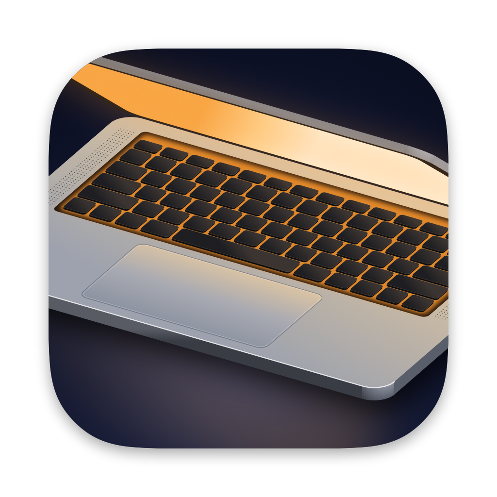
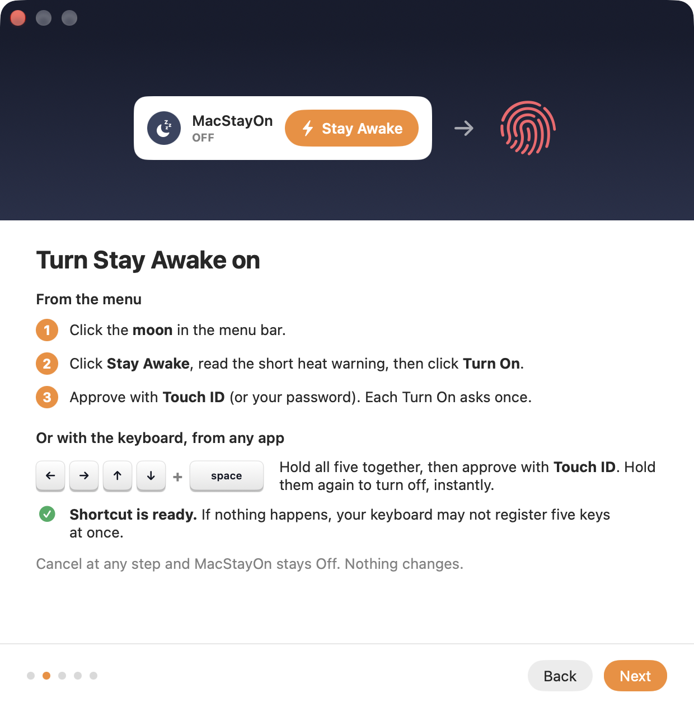
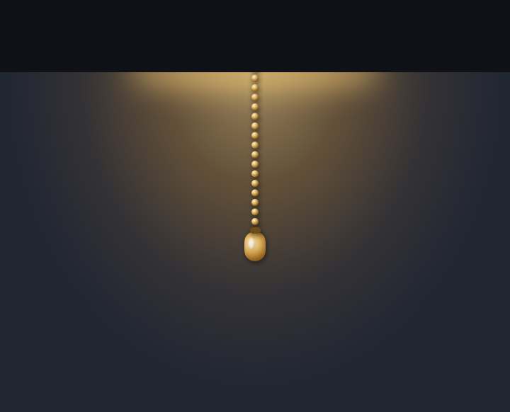
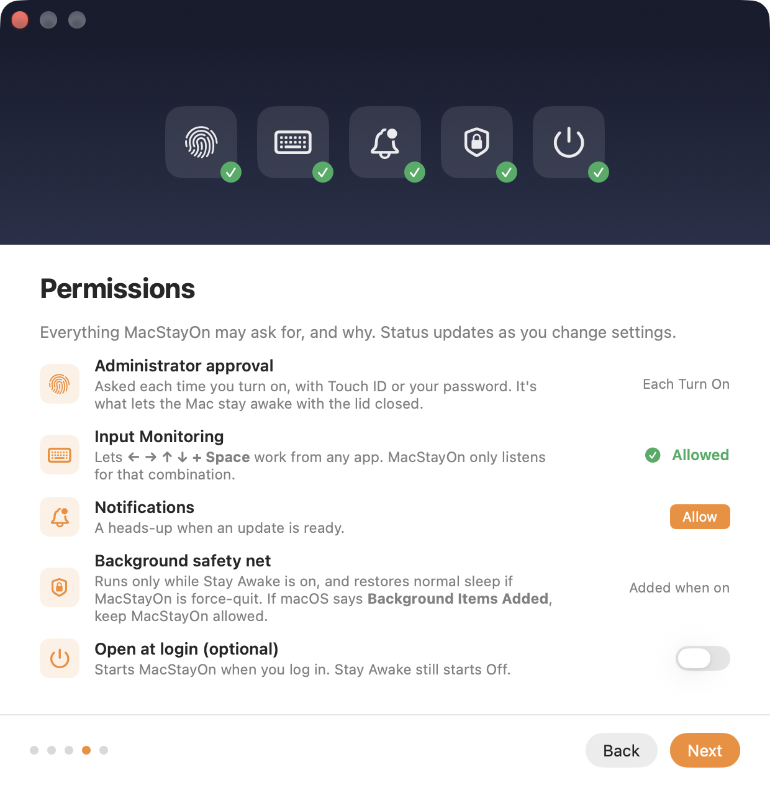

<p align="center">
  
</p>

<h1 align="center">MacStayOn</h1>

<p align="center">
  Keep your Mac awake with the lid closed, so agents, builds and downloads keep running.<br>
  <sub>A small menu bar app. Turn it on, close the lid, walk away. Turn it off and normal sleep comes back.</sub>
</p>

<p align="center">
  <a href="https://github.com/markadebartolo/MacStayOn/releases/latest"><strong>Download for Mac (Apple Silicon)</strong></a>
  &nbsp;·&nbsp;
  <a href="https://github.com/markadebartolo/MacStayOn/releases">All releases</a>
</p>

<p align="center">
  
  
  
  
  
</p>

<p align="center">
  
</p>

---

## Why MacStayOn

Close the lid and keep working. **Cursor, Claude, builds and other long-running jobs** keep going without an external display, on battery or plugged in. MacStayOn lives in the **menu bar**: one click (or one key combination) turns it on, and turning it off brings **normal lid sleep** back.

> **Safety first:** a closed Mac can overheat in a bag or under a blanket. MacStayOn warns you before turning on, and the **heat and battery guard** turns it off by itself on low battery or serious heat. On a fanless **MacBook Air** or **MacBook Neo**, the warning also advises shorter closed-lid sessions.

## Features

- **Stay Awake, lid open or closed.** Blocks lid sleep and the screensaver while on, and works on battery without a monitor.
- **Two ways to turn on.** Use the menu, or hold **← → ↑ ↓ + Space** together from any app. Either way you approve once with **Touch ID** (or your password).
- **Glow confirmation.** Every time Stay Awake turns on or off, a brass pull chain drops from the menu bar, gets a tug with a click, and a warm glow comes on (or goes out). Then it tucks away. It's a quick sign that it worked, especially from the keyboard, and nothing stays on screen.
- **Built-in guide.** A short walkthrough opens the first time you launch MacStayOn. It covers turning on, the glow, permissions and updates, and you can reopen it any time from **?** in the menu. After each update it shows what's new.
- **Permissions, explained.** The guide lists everything MacStayOn may ask for, says why, shows whether each one is set up, and has a button to fix any that isn't.
- **Automatic updates that never interrupt.** New versions download in the background and install **only while Stay Awake is off**. Then MacStayOn reopens with what's new.
- **Heat and battery guard.** Turns Stay Awake off at a battery level you choose (10–50%) or on serious heat.
- **Darken.** Optional black cover while on; the Mac stays awake. Any key or click brings the screen back.
- **Lid-close flash and lid-open check.** While on, the screen pulses orange as you close the lid (on Macs with a lid-angle sensor). When you open it again, MacStayOn asks whether to turn off or keep going.
- **Bag-safe Off.** Turning off or quitting always restores normal lid sleep and removes MacStayOn's background safety helper, so nothing is left keeping the Mac awake.
- **Menu bar and Dock.** The moon (sun when on) in the menu bar, and the icon in the Dock: click it to open the menu, or right-click for **Stay Awake…**, **Turn Off** and the **Guide**. Nothing is sent to a server.

<p align="center">
  
  &nbsp;&nbsp;
  
</p>

---

## Get started

1. Download **[MacStayOn-macos-arm64.zip](https://github.com/markadebartolo/MacStayOn/releases/latest)** and unzip it.
2. Drag **MacStayOn.app** into **Applications** and open it. It's notarized, so it opens normally. If you open it from Downloads instead, MacStayOn offers to move itself to Applications.
3. The **guide** opens and walks you through the rest. In short:
   - Click the **moon** in the menu bar, click **Stay Awake**, read the heat note, click **Turn On**, and approve with **Touch ID**.
   - Or hold **← → ↑ ↓ + Space** from any app, then approve with Touch ID.
4. Close the lid. When you open it again, MacStayOn asks whether to restore normal sleep or stay on.

### Who can use the download

| | |
|--|--|
| **Works on** | **Apple Silicon** Macs (M1, M2, M3, M4, …) · **macOS 13 Ventura** or later |
| **File** | `MacStayOn-macos-arm64.zip`, **arm64 only** (not a universal or Intel build) |
| **Best on** | MacBook, MacBook Air, MacBook Pro (closing the lid is the main use) |
| **Also OK** | Apple Silicon desktops, for stay-awake and no-screensaver (no lid flash or lid-open prompt) |
| **Not for** | **Intel Macs**, Windows, or macOS 12 and older |

Not sure which chip you have? Apple menu → **About This Mac** → **Chip**. If it says **Intel**, this download won't run.

---

## Permissions

MacStayOn asks for as little as it can. The guide's **Permissions** step shows the live status of each one.

| Permission | Why | When |
|---|---|---|
| **Administrator approval** (Touch ID or password) | Lets the Mac stay awake with the lid closed (`pmset disablesleep`) | Each time you turn on |
| **Input Monitoring** | The **← → ↑ ↓ + Space** shortcut. MacStayOn only listens for that combination; your keys still reach your apps | Optional, only for the shortcut |
| **Notifications** | A heads-up when an update is ready | Optional |
| **Background item** ("Background Items Added") | MacStayOn's safety net, which restores normal sleep if the app is force-quit. Runs only while Stay Awake is on, and is listed as MacStayOn | Added when you turn on, removed when you turn off |
| **Login item** | Opens MacStayOn when you log in. Stay Awake still starts **Off** | Optional |

---

## The menu

Click the moon (sun when on) in the menu bar, or the MacStayOn icon in the Dock. A small panel opens right under the moon, in the app icon's colors: the status card on top is night navy when off and warm amber when on.

| Part | What it shows or does |
|------|------------------------|
| **Status** | Normal sleep, or Staying awake with how long it's been on, plus the chip and battery. Off, it also shows the last session |
| **Stay Awake / Restore Normal Sleep** | The main button. Turns Stay Awake on (heat note, then Touch ID) or off. Under it: the keyboard shortcut, or a link to set it up |
| **While on** | **Darken screen** (black cover, the Mac stays awake; any key or click brings it back) and the **heat and battery guard** (turns off at your battery level, 10–50%, or on serious heat) |
| **App** | **Glow confirmation** on turn on and off, and **Open at login** |
| **Guide · Updates · Quit** | The guide, a check for updates (orange when one is ready), and Quit, which restores normal sleep first |

The heat warning before turning on, the "lid opened" choice and any errors show inside the panel, in place of the main button.

## Updates

MacStayOn checks **once a day** (Sparkle, from this repo's GitHub Releases). When a new version is out:

1. It **downloads in the background**.
2. It **installs only while Stay Awake is off**. If a session is running, the update waits until you turn it off, so it never cuts one short.
3. MacStayOn **reopens and shows what's new**. Your settings and permissions carry over.

Prefer to install updates yourself? Open the guide (**?**), go to **Updates**, and turn off **Install updates automatically**. The **Updates** button turns orange when one is ready.

---

## What happens under the hood

| When you turn **On** | When you turn **Off** or **Quit** |
|----------------------|-----------------------------------|
| `pmset disablesleep` (admin approval, Touch ID when offered), IOKit stay-awake assertions, screensaver blocked, and a sleep-safety LaunchDaemon as a backstop | A root watchdog restores normal lid sleep and removes that daemon, with **no password** in the usual case |
| Works on **battery** without a monitor | If the watchdog was killed, Off asks for admin to clear stuck sleep. Off never leaves `SleepDisabled` on, or a leftover daemon (bag safety) |

`PreventSystemSleep` alone isn't enough on battery; MacStayOn uses the same approach power users rely on for closed-lid work.

---

## Build from source

```bash
brew install xcodegen
./scripts/build.sh
open dist/MacStayOn.app
```

Open in Xcode: `xcodegen generate && open MacStayOn.xcodeproj`

Run the tests. No admin rights are needed: the root scripts run against a sandbox, never the real `pmset`.

```bash
xcodegen generate
xcodebuild -project MacStayOn.xcodeproj -scheme MacStayOn -configuration Debug \
  -derivedDataPath build/DerivedDataTest CODE_SIGNING_ALLOWED=NO test
```

The app icon is drawn in code (`scripts/app-icon/main.swift`). To regenerate every size and `docs/media/MacStayOn.icns`, run `./scripts/make-app-icon.sh`.

**Sign, notarize and publish updates** (Developer ID + Sparkle appcast): see **[docs/DISTRIBUTE-MAC.md](docs/DISTRIBUTE-MAC.md)**.

Update feed: `https://github.com/markadebartolo/MacStayOn/releases/latest/download/appcast.xml`

## Verify (optional)

```bash
pmset -g | grep SleepDisabled       # 1 while On, 0 when Off
pmset -g assertions | grep -i MacStayOn
spctl -a -vv /Applications/MacStayOn.app   # Notarized Developer ID
```

---

<p align="center">
  <sub>Menu bar app · Lid closed, still working · Notarized builds with automatic updates on Releases</sub>
</p>
